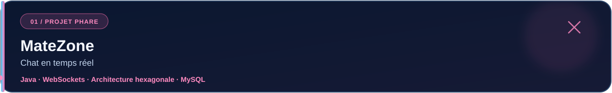
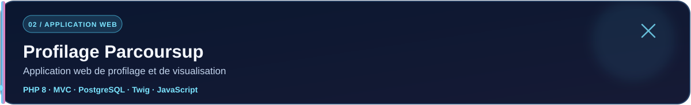
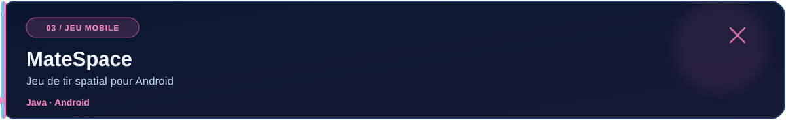
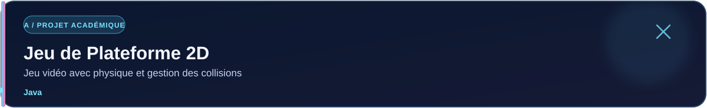
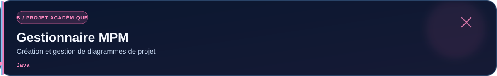
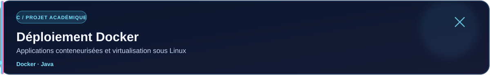
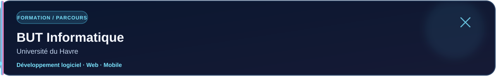

Étudiant en **BUT Informatique à l’Université du Havre**, je développe des applications web, mobiles et logicielles.  
J’aime transformer un besoin en solution concrète, avec une attention particulière à la structure du code, à l’expérience utilisateur et au travail en équipe.

[**Voir le code ↗**](https://github.com/Joshua-Hermilly/MateZone)　·　[Visiter le site](https://www.m8yuriko.fr)

[**Voir le dépôt ↗**](https://github.com/Dono0530/Profilage-Parcoursup)

[**Voir le dépôt ↗**](https://github.com/Dono0530/MateSpace)

<a href="https://github.com/Dono0530/S1.01-Platformer"><strong>Ouvrir le dépôt ↗</strong></a>

<a href="https://github.com/Dono0530/S2.01-S2.02-S2.05-MPM"><strong>Ouvrir le dépôt ↗</strong></a>

Ouvert aux échanges autour du développement logiciel, des projets web et des collaborations.

